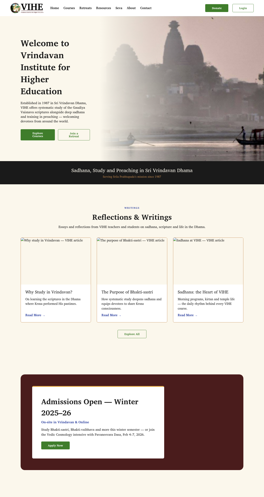
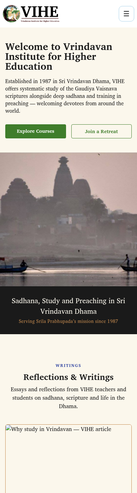

# VIHE Site Concept

[](https://github.com/bt108/vihe-site-concept/actions/workflows/deploy.yml)
[](https://astro.build)

A redesign concept for the Vrindavan Institute for Higher Education website:
a static Astro + Tailwind site with all copy, courses, and palette in a single
config file. The institute did not adopt it, so this is a frozen demo, not the
live VIHE site. For readers browsing the concept — courses, retreats,
resources, and contact details as proposed.

**Live demo:** https://bt108.github.io/vihe-site-concept/
(deployed from `master` via the GitHub Actions workflow)

## 30-second example

Page copy lives in `site/src/config/org.ts`; the hero block:

```ts
hero: {
  image: import.meta.env.BASE_URL + 'assets/hero.jpg',
  title: 'Welcome to Vrindavan Institute for Higher Education',
  sub: 'Established in 1987 in Sri Vrindavan Dhama, VIHE offers systematic study ...',
  ctas: [
    { label: 'Explore Courses', href: '#courses' },
    { label: 'Join a Retreat', href: '#retreats' },
  ],
},
```

```sh
cd site
npm install   # or: npm ci (as CI does)
npm run dev   # local preview under /vihe-site-concept/ (project-pages base)
npm run build # static output in site/dist/
```

## Sample output

Built from `site/dist/` and rendered in Chromium:

| Desktop | Mobile |
|---|---|
|  |  |

## Prerequisites

- Node.js 20 — runs the Astro toolchain (CI pins `node-version: 20`).
- npm — installs dependencies and runs the `dev` / `build` scripts.

## Commands

Run from `site/`:

```sh
npm install   # install dependencies (CI uses npm ci)
npm run dev   # local preview under /vihe-site-concept/
npm run build # static build to site/dist/
npm run preview  # serve the site/dist/ build locally
npm run check    # astro check (type-checks; currently reports 10 pre-existing
                 #   strict-TS errors in Header/Base — build is unaffected)
```

## Project layout

```
site/astro.config.mjs       # static output + /vihe-site-concept/ base for Pages
site/src/config/org.ts      # single source of truth: copy, courses, palette
site/src/components/        # one section component per page block
site/src/layouts/Base.astro # shared shell (head, nav, mobile-menu script)
site/src/pages/index.astro  # the single page, composed from components
site/tailwind.config.cjs      # Tailwind wired to the institute palette
site/public/assets/         # logo + hero photo (placeholders/ for the rest)
site/dist/                  # build output (git-ignored)
.github/workflows/deploy.yml  # CI: npm ci + build, deploy dist/ to Pages
docs/img/                   # desktop.png + mobile.png renders for this README
other-files/                # local-only reference scrap (git-ignored, never committed)
```

## Content model

- **org.ts** holds every string on the page (nav, hero, courses, retreats,
  resources, seva columns, footer) plus the 9-token palette.
- **Components** take no hard-coded copy; props default to the org values, so
  re-skinning means editing `org.ts` plus logo/photos, not markup.
- **Tailwind config + CSS variables** in `Base.astro` derive from the same
  palette; no one-off hex values in components.
- **Astro static output** renders one `index.html` to `site/dist/`, deployed
  to GitHub Pages from `master`.
- **Frozen scope**: no backend; action links point at `#contact`; course data
  is Winter 2025–26 sample copy.
